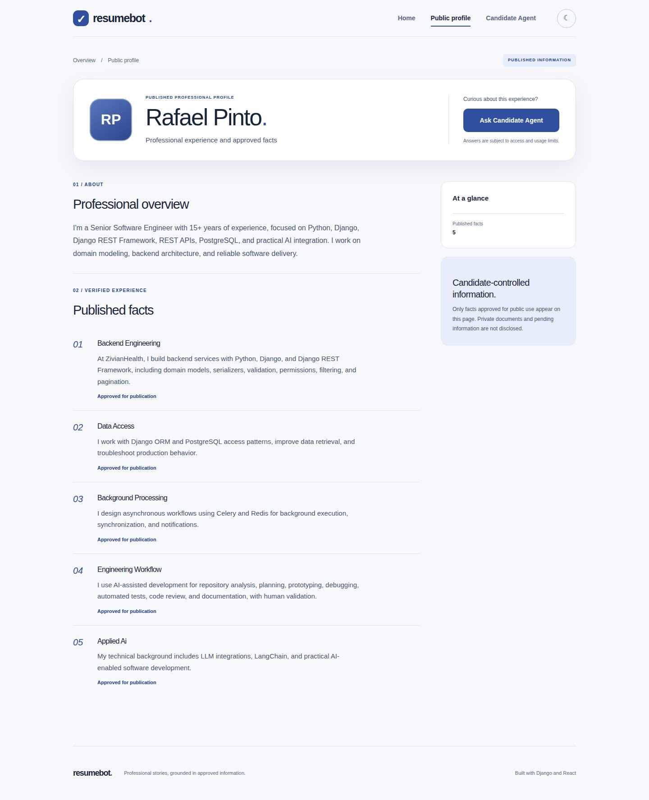
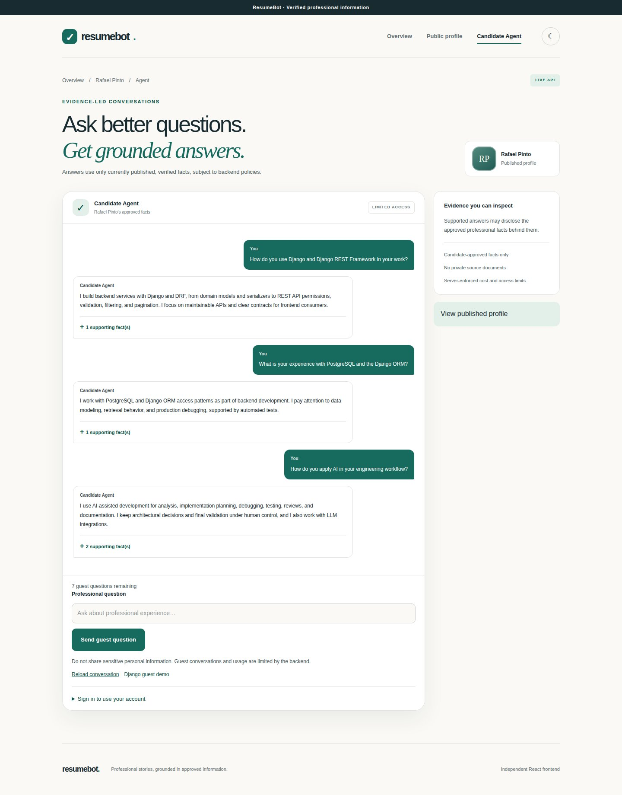

# ResumeBot

ResumeBot is a full-stack application for publishing candidate-controlled professional profiles and answering recruiter questions through a focused, evidence-backed Candidate Agent. Instead of improvising a biography, the agent speaks in the candidate's **first-person voice** and builds answers from professional facts the candidate has verified and explicitly made public. Each cited fact is checked again before an answer is returned.

The application combines a **Python/Django REST Framework backend**, **PostgreSQL**, and a separately built **React/TypeScript** frontend. It demonstrates API design, domain modeling, LLM integration, privacy boundaries, and the operational constraints of serving AI features to occasional anonymous visitors.

## What it does

- **Public professional profiles:** published summaries and individually approved experience, skills, and project facts.
- **Candidate Agent:** contextual recruiter Q&A, with first-person answers and inspectable supporting evidence.
- **Owner workspace:** profile editing, fact verification, publication, withdrawal, and private provenance.
- **Controlled AI access:** authenticated and optional Turnstile-protected guest conversations, server-side quotas, idempotency, and daily/monthly cost limits.
- **Evidence-based retrieval:** a full-context production path with independent PostgreSQL full-text and pgvector/LangChain comparison tooling.

## Product walkthrough

### Published professional profile

A candidate's public profile exposes approved experience without revealing source documents or unpublished information.



### Candidate Agent

Recruiters can ask about backend engineering, Django REST Framework, PostgreSQL, and applied AI. Answers use the candidate's voice and display the professional facts behind them.



## Architecture

```text
React + TypeScript + Vite (independent static frontend)
             |
             | Versioned REST API / OpenAPI types
             v
Django + Django REST Framework
  |-- Candidate profiles, publication and authorization
  |-- Owner-only fact review and audit
  |-- JWT login / refresh and CSRF-protected guest sessions
  |-- Candidate Agent and AI usage policies
  |      |-- Fact retrieval: verified + published only
  |      |-- Structured LLM response and evidence validation
  |      `-- Quota, budget reservation and usage reconciliation
  |
  +-- PostgreSQL (profiles, facts, conversation history, AI ledger)
            |-- Full-text search comparison
            `-- pgvector experimental retrieval
```

The backend is a modular Django monolith rather than a collection of distributed services. React is deployed separately and consumes versioned DRF endpoints; **drf-spectacular/OpenAPI** generates the TypeScript API contract. Django's WhiteNoise serves its own static assets, not the React bundle.

**Python 3.12, Django, Django ORM, Django REST Framework, PostgreSQL, React, TypeScript, Vite, OpenAI APIs, LangChain, pgvector, pytest, Vitest, Playwright, and GitHub Actions** are used where they serve concrete application or engineering requirements. Celery and Redis are not required for this small deployment.

## Engineering decisions

| Concern | Implementation |
| --- | --- |
| Source of truth | Candidate facts are separately verified and published; source files and extracted text remain private. |
| Model boundary | The LLM receives only approved facts and prior questions; it returns structured answers with fact IDs that Django reauthorizes. |
| Answer behavior | The Candidate Agent answers in the candidate's first person, with an explicit refusal when verified evidence is unavailable. |
| Authorization | Owner actions and private records are guarded server-side; guest access has its own session and Turnstile policy. |
| AI cost control | Quotas, request idempotency, budget reservation, token-usage reconciliation, and a global AI kill switch. |
| Retrieval trade-offs | Full context remains the production choice; PostgreSQL FTS and LangChain/pgvector are evaluated independently. |
| Contract quality | OpenAPI-generated TypeScript types are checked for drift in CI. |
| Release safety | Independently buildable apps, Django deployment checks, read-only HTTP smoke checks, and deliberately disabled paid features by default. |

These controls are intentionally conservative for a portfolio application. An evidence reference is validated for access, but a citation alone is not proof that every generated sentence follows logically from its source. The evaluation process measures that limitation rather than claiming it is solved.

## Run locally

Requires Python 3.12, [uv](https://docs.astral.sh/uv/), Node.js 22+, and PostgreSQL with pgvector support.

```sh
uv sync
cp .env.example .env
# Set local database credentials in .env and export the variables.
uv run python manage.py migrate
uv run python manage.py createsuperuser
uv run python manage.py runserver
```

In a separate terminal:

```sh
cd frontend
npm ci
cp .env.example .env.local
npm run dev
```

Django runs at `http://localhost:8000`; the standalone frontend runs at `http://localhost:4173`. Django does not automatically read `.env`, so load those variables into the backend process before migrating or starting the server. Public registration is not required to create the initial owner account.

Live AI interactions require an explicit provider key, approved public facts, enabled operation policy, and sufficient configured budgets. Public pages and the test suite work without paid API calls.

## Test and validate

```sh
uv run pytest
uv run ruff check .
uv run ruff format --check .
uv run python manage.py check
uv run python manage.py makemigrations --check --dry-run

npm --prefix frontend run build
npm --prefix frontend test
npm --prefix frontend run test:e2e
npm --prefix frontend run test:deploy
```

CI runs Django tests with PostgreSQL/pgvector, offline Candidate Agent evaluations, migration/deployment checks, frontend unit and browser tests, and generated OpenAPI type-drift checks. The release smoke checker uses read-only HTTP requests; it never calls a paid LLM.

## Deployment status

The repository includes an **opt-in Render Blueprint** for separate Django and React services, HTTPS/cookie/CORS safeguards, and deployment instructions. It is **not a claim of a live production deployment**. A persistent PostgreSQL database, real DNS/TLS, a verified backup policy, and browser checks are still required before public release.

AI, guest chat, public registration, and file uploads are disabled by default in production until their operational prerequisites are met. See the [production runbook](docs/engineering/DEPLOYMENT.md) before enabling them.

## Technical documentation

- [System architecture and trust boundaries](docs/engineering/ARCHITECTURE.md)
- [Versioned REST API](docs/engineering/REST_API.md) and [JWT API security](docs/engineering/JWT_API_SECURITY.md)
- [Frontend development](frontend/README.md) and [UI design system](docs/design/DESIGN_SYSTEM.md)
- [Candidate knowledge import](docs/engineering/FACT_IMPORT.md) and [anonymous chat policy](docs/engineering/GUEST_CHAT.md)
- [Offline evaluation](docs/engineering/AI_EVALUATION.md) and [retrieval experiments](docs/engineering/PAID_AI_EVALUATION.md)
- [Deployment and rollback](docs/engineering/DEPLOYMENT.md)
- [Engineering roadmap](docs/roadmap/ROADMAP.md) and [architecture decisions](docs/adr/)
